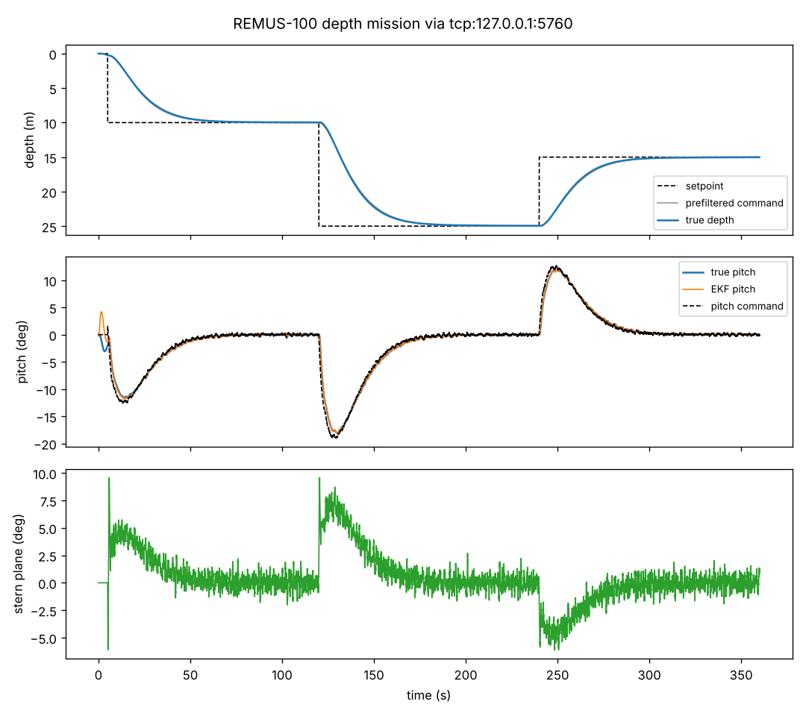

# auv-autopilot

A C++17 depth autopilot and attitude estimator for a simulated underwater
vehicle. The same core is used by the Linux runner and STM32F446 firmware.



## Status

Software-in-the-loop is working. The supplied 40-run study reports 4.2 cm
median settled depth error and 0.069° median pitch RMS error. Firmware has
not been run on a board. The EKF's covariance is conservative; see the report.

## Build and test

Needs CMake 3.20+, a C++17 compiler, Ninja, and Python 3.10+.

```bash
pip install -r requirements.txt
cmake -S . -B build -G Ninja
cmake --build build --parallel 2
ctest --test-dir build --output-on-failure
(cd sim && python -m unittest discover -s tests -v)
bash scripts/run_sil.sh
# Or run the complete host checks:
bash scripts/check_host.sh
```

## Layout

- `core/`: EKF, depth controller, and framed protocol; fixed-size storage.
- `host/`: TCP runner and estimator replay.
- `sim/`: REMUS-100 model, sensor simulation, missions, and Monte Carlo study.
- `firmware/`: STM32F446, FreeRTOS, SPI IMU, and UART/DMA.

The estimator tracks roll, pitch, and two gyro biases. Depth control uses
an outer depth loop and inner pitch loop with actuator limits and anti-windup.
Messages use COBS framing and CRC-16 over TCP or UART. Input checks reject
invalid samples. HIL includes a sensor-stream timeout; SPI polling is bounded.
Real-time runs count replies against the 20 ms period and report link latency.

## Limits

Gains are tuned at 1200 rpm on one simulated hull. The EKF does not estimate
yaw. The firmware outputs serial actuator messages; physical PWM outputs,
depth-sensor hardware, and on-board timing measurements are pending.

## Details

[Design](docs/DESIGN.md) · [Results](docs/REPORT.md) ·
[Hardware setup](docs/HARDWARE.md) · [Fault behavior](docs/FAULTS.md) ·
[Changes](CHANGELOG.md)

Vehicle dynamics: Fossen's Python Vehicle Simulator, MIT license.
See [third-party notices](THIRD_PARTY_NOTICES.md). MIT license.
