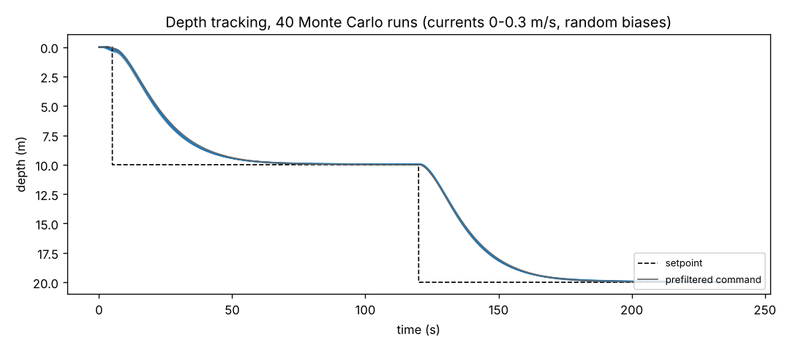
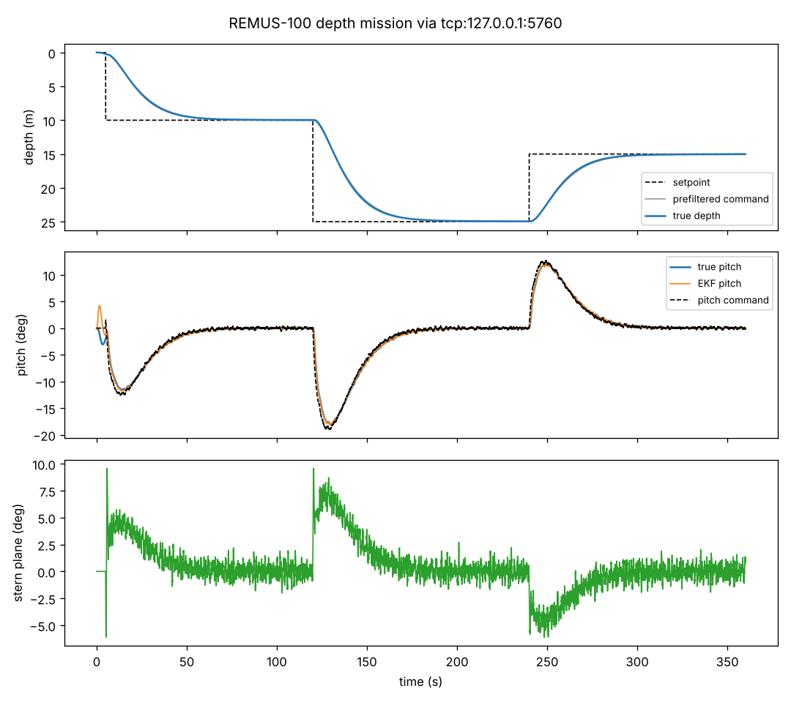
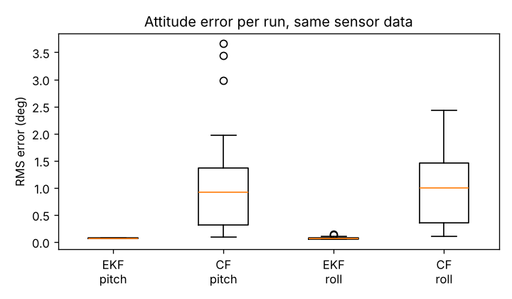
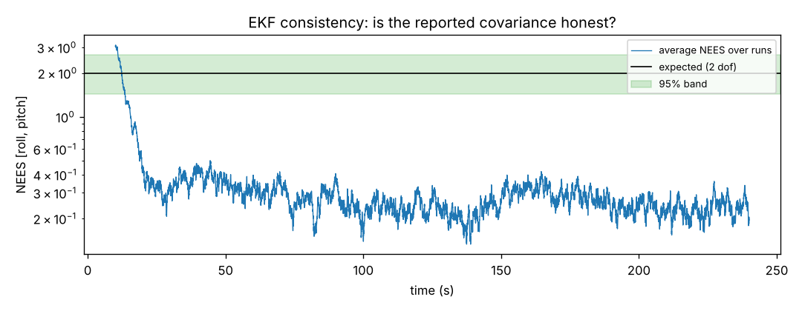
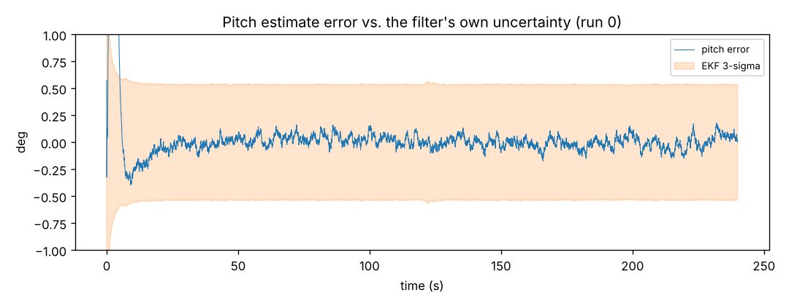

# AUV depth autopilot: simulation results

All numbers below come from `sim/monte_carlo.py` (40 runs) and
`scripts/run_sil.sh` (one 6-minute mission), run in software-in-the-loop on
a 2-core Linux VM. Nothing here has been measured on hardware yet; see
"Limits" at the end.

## 1. Setup

* **Vehicle**: REMUS-100 6-DOF model from Fossen's Python Vehicle Simulator
  (1.6 m, 32 kg), propeller at 1200 rpm (about 2 m/s). Physics integrated
  at 200 Hz.
* **Sensors**, sampled at 50 Hz:
  gyro white noise 0.002 rad/s per sample, constant bias with σ = 0.01 rad/s
  per axis plus a random walk of 10⁻⁴ rad/s/√s; accelerometer noise
  0.08 m/s² per sample, measuring true specific force (so the vehicle's own
  accelerations show up in it); depth noise 2 cm, quantised to 1 cm.
* **Disturbances**: a constant water current, 0–0.3 m/s in a random
  direction; initial pitch drawn from N(0, 3°).
* **Monte Carlo mission**: hold the surface, dive to 10 m at t = 5 s, then to
  20 m at t = 120 s, end at 240 s. 40 runs, each with its own seed, current
  and starting pitch.
* **Autopilot**: the C++ core (`core/`), driven over TCP in lockstep by the
  simulator, exactly as the board would be driven over serial.

## 2. Results

| Metric (40 runs) | Median | 95th pct. | Worst |
|---|---|---|---|
| Depth error, last 30 s of each level (m) | 0.042 | 0.064 | 0.068 |
| Overshoot past 20 m (m) | 0.000 | 0.000 | 0.002 |
| Depth tracking RMS vs prefiltered command (m) | 0.071 | 0.106 | 0.109 |
| Largest stern-plane angle (deg, limit 15) | 8.9 | 11.3 | 11.5 |
| EKF pitch error RMS (deg) | 0.069 | 0.075 | 0.081 |
| EKF roll error RMS (deg) | 0.065 | 0.104 | 0.142 |
| Complementary filter pitch error RMS (deg) | 0.91 | 3.0 | 3.7 |
| Complementary filter roll error RMS (deg) | 1.00 | 2.1 | 2.4 |
| Final gyro-bias error, pitch axis (rad/s) | < 0.001 | 0.001 | 0.001 |
| `Autopilot::step` time on the host (ns) | 822 | 882 | 966 |

The supplied study had 0 missing replies and 0 CRC errors in lockstep mode.
Lockstep results do not establish a real-time deadline or on-target execution time.



The single 6-minute mission (`docs/img/mission.png`, setpoints 10 → 25 →
15 m) gives the same picture: 0.092 m tracking RMS, 0.064° pitch error,
largest plane angle 9.6°.



Two features of that plot are worth explaining. In the first 5 s the EKF
pitch rises to about +4° while the true pitch dips: that is the propeller
spinning up, a forward acceleration the accelerometer can't tell apart from
tilt. The planes are held neutral for those 5 s for exactly this reason
(DESIGN.md, "Arming delay"). And each new setpoint produces a brief plane
deflection of up to about 10°: the prefilter starts the commanded dive rate
ramping immediately, and the inner loop chases the pitch command hard. It
stays inside the 15° limit, and a third-order prefilter would soften it if
it mattered.

## 3. What the tuning taught

### 3.1 Controller: from 0.75 m to 0.07 m

The first working version used a first-order setpoint prefilter and put the
outer loop's damping on the measured depth rate. Over the same 40 runs it
had:

| | First version | Final |
|---|---|---|
| Tracking RMS (m, median) | 0.75 | 0.071 |
| Depth error, last 30 s (m, median) | 0.30 | 0.042 |
| Overshoot past 20 m (m, median) | 0.35 | 0.000 |

Looking at one run showed why. During a dive the vehicle fell about 1.3 m
behind the command. Damping on the *measured* depth rate pushes back
against any descent, including the one being asked for. The integrator then
filled up during the lag, carried the vehicle past the target, and took a
minute or more to bleed off.

Three changes, each tested on its own:

1. Damp the depth-rate **error** (`ż − ż_d`), not the raw rate. Tracking
   RMS 0.75 → 0.49 m, but the planes now hit their 15° limit, because a
   first-order prefilter's rate jumps the instant the setpoint changes.
2. Use a **second-order prefilter**, whose rate starts at zero. The limit
   hits went away (largest plane 7.5°).
3. Add **feedforward** of the commanded dive rate to the pitch command, so
   the integrator doesn't have to supply it. A sweep of the gain over
   0.3 / 0.6 / 0.9 rad per m/s gave tracking RMS 0.26 / 0.07 / 0.34 m;
   0.6 is used. The best total gain (feedforward 0.6 plus damping 0.3) is
   larger than 1/U = 0.5 that geometry alone would suggest, because the
   hull's angle of attack means the vehicle descends less steeply than it
   points.

The feedforward gain depends on speed, so it would need scheduling on rpm
for a vehicle that changes speed.

### 3.2 Estimator: accurate, but not consistent

**EKF vs complementary filter.** On identical sensor data the EKF's pitch
error is about 13× smaller (0.069° vs 0.91° median). The complementary
filter has no bias state, so a gyro bias of 0.01 rad/s leaves it with a
standing error of roughly `bias × τ` = 0.01 × 2 s ≈ 1°. The EKF estimates
the bias and removes it.



**Consistency (NEES).** An EKF also reports how uncertain it is (its
covariance P). The normalised estimation error squared,
`NEES = eᵀ P⁻¹ e` over the [roll, pitch] error `e`, should average 2 (the
number of states checked) if P is honest. Averaged over 40 runs, the 95%
band for that average is [1.43, 2.67].



The filter is **not** consistent: the time-averaged NEES is 0.32, well
below the band. Its covariance is about 6× too large, so it is
*conservative*: it says ±0.18° (1σ) when the real error is closer to ±0.07°.



The cause is the gyro noise setting. The simulator's gyro noise
(0.002 rad/s per 50 Hz sample) is equivalent to a noise density of about
0.0003 rad/s/√Hz, while the filter uses 0.003, ten times more. Lowering it
(`python3 sim/monte_carlo.py --gyro-noise X`):

| EKF gyro noise setting | 0.003 (used) | 0.001 | 0.0004 |
|---|---|---|---|
| Average NEES (ideal 2.0) | 0.32 | 1.18 | 1.89 |
| Pitch error RMS (deg, median) | **0.069** | 0.109 | 0.128 |
| Roll error RMS (deg, median) | 0.065 | 0.063 | 0.064 |
| Time steps with NEES inside the band | 1% | 1% | 8% |

At the "correct" value the *average* NEES is right, but the pitch error
almost doubles, and the NEES still sits outside its band most of the time,
swinging high during dives and low in between. That pattern points to an
error the model doesn't contain, not a wrong noise number: the accelerometer
sees the vehicle's own accelerations (surge, heave, and the centripetal
term while pitching), and the filter treats them as white noise. Increasing gyro process noise raises predicted uncertainty and generally
strengthens accelerometer corrections. It also changes the bias-state
coupling. The sweep shows an accuracy improvement, but does not isolate its
cause; a controlled innovation and bias analysis is needed before assigning
that improvement to a specific mechanism.

The trade-off chosen here: keep the inflated setting, because the
controller only needs the estimate, and the estimate is better. The cost is
that P overstates the uncertainty, so anything downstream that trusted P
(fault detection, for example) would be too lenient. The principled fix is
to model the acceleration: feed the propeller-thrust and depth-rate-derived
accelerations into the measurement model, or add speed from a DVL.

## 4. Firmware

The firmware cross-compiles without warnings for both modes
(arm-none-eabi-gcc 13.3.1, `-Os`, Cortex-M4F with hardware single
precision):

| Mode | Flash | RAM |
|---|---|---|
| HIL | 18.4 KB / 512 KB | 28.3 KB / 128 KB |
| BENCH | 19.0 KB / 512 KB | 28.3 KB / 128 KB |

RAM is mostly the 24 KB FreeRTOS heap that holds the task stacks and queue.

## 5. Limits

* **Not run on hardware.** The HIL and BENCH firmware builds have not been
  flashed to a board. The IMU register settings and pin assignments are from
  the datasheets and need the bring-up checklist in HARDWARE.md. The control
  step time on the STM32 is unmeasured; on the host it is under 1 µs, so
  50 Hz leaves a margin of several orders of magnitude even if the M4 is
  100× slower.
* **The simulator is the model the controller was tuned on.** Results on a
  different hull, or with sensor errors the simulator doesn't produce
  (scale factor, misalignment, vibration, temperature drift), will be worse.
* **No magnetometer, so no yaw estimate.** The rudder only damps yaw rate.
* **Accelerometer aiding assumes small accelerations.** Section 3.2.
* **Fixed gains, one speed.** Section 3.1.

## 6. Reproduce

```bash
cmake -S . -B build -G Ninja && cmake --build build
ctest --test-dir build                       # C++ unit tests
(cd sim && python3 -m unittest discover -s tests)   # Python tests incl. closed loop
scripts/run_sil.sh runs/mission               # one mission, plot + summary
python3 sim/monte_carlo.py --runs 40          # this report's tables and plots (~4 min on 2 cores)
python3 sim/monte_carlo.py --runs 40 --gyro-noise 0.0004 --no-plots
```
